<div align="center">

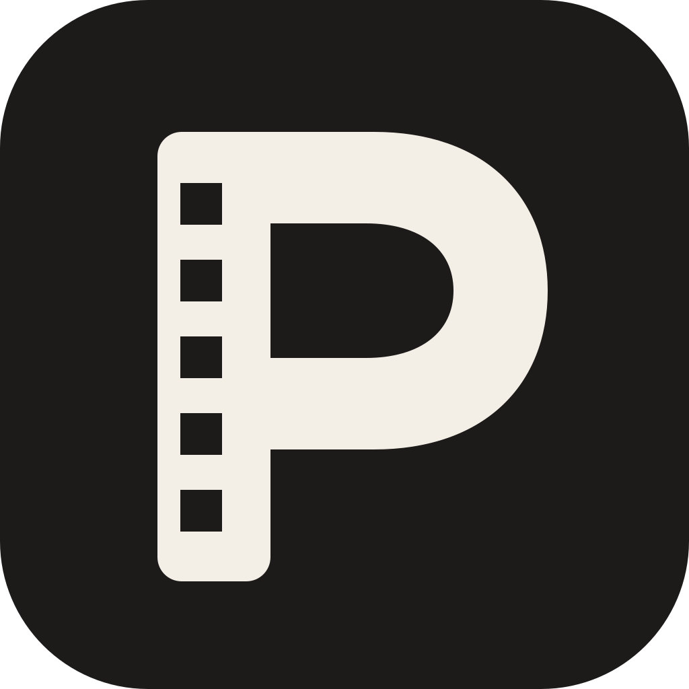

# PosterBoxd Studio

[](https://posterboxd.com/)
[](CHANGELOG.md)
[](https://github.com/emmanuelmavely/PosterBoxdPlus/actions/workflows/static.yml)


[](https://www.themoviedb.org/)

**A modern, browser-based review poster generator for cinema and television.**  
Craft custom high-resolution posters (up to 1200×1800) by searching any movie or TV series via TMDB or importing any Letterboxd review link (including short `https://boxd.it/...` URLs). Choose from 11 responsive poster layouts, extract automatic color palettes, and reposition elements with interactive drag-and-scale controls.

**Live Website:** [posterboxd.com](https://posterboxd.com/)  
*Everything runs 100% client-side in your browser: no backend servers, no build step, and no login required.*

</div>

---

## Sample Poster Outputs

Here are sample high-resolution posters generated across different archetypes:

<div align="center">
  <table>
    <tr>
      <td align="center" width="33%">
        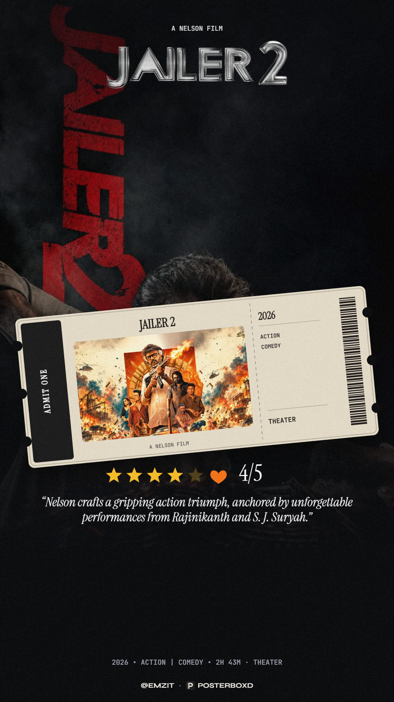
        <br /><sub><b>1. Floating Vintage Ticket</b></sub>
      </td>
      <td align="center" width="33%">
        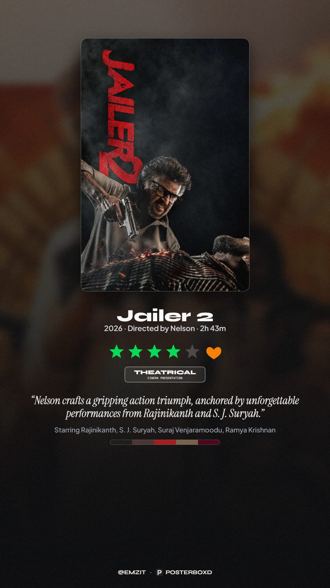
        <br /><sub><b>2. Classic Centered</b></sub>
      </td>
      <td align="center" width="33%">
        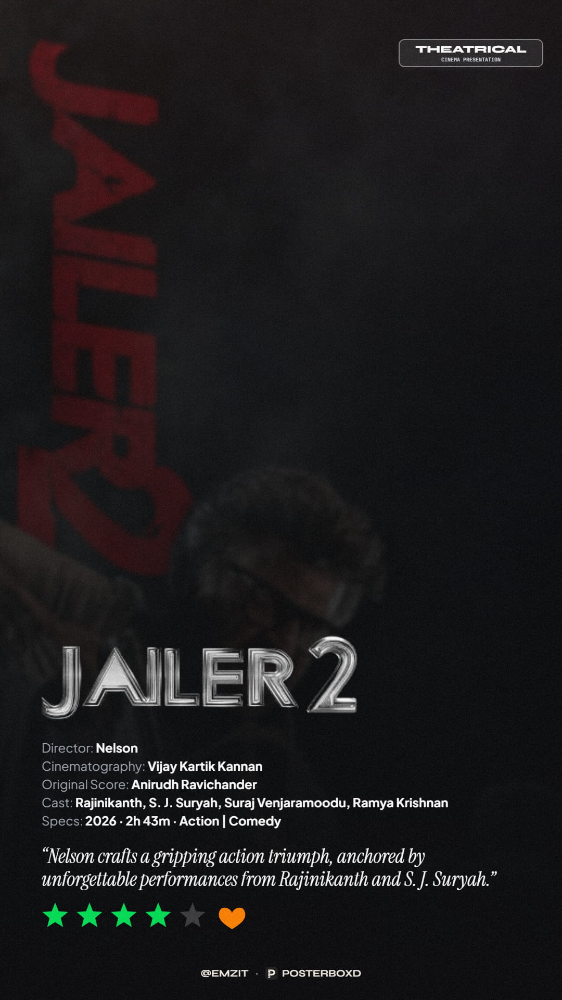
        <br /><sub><b>3. Full-Bleed Editorial</b></sub>
      </td>
    </tr>
    <tr>
      <td align="center" width="33%">
        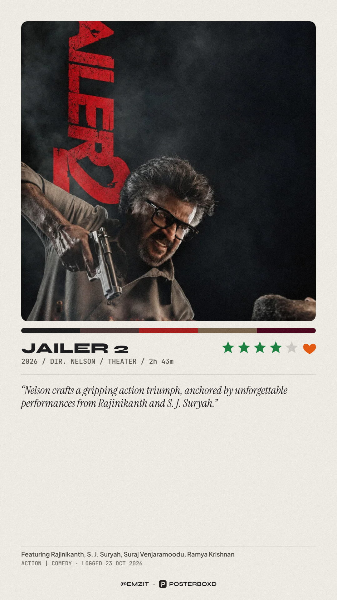
        <br /><sub><b>4. Polaroid Frame</b></sub>
      </td>
      <td align="center" width="33%">
        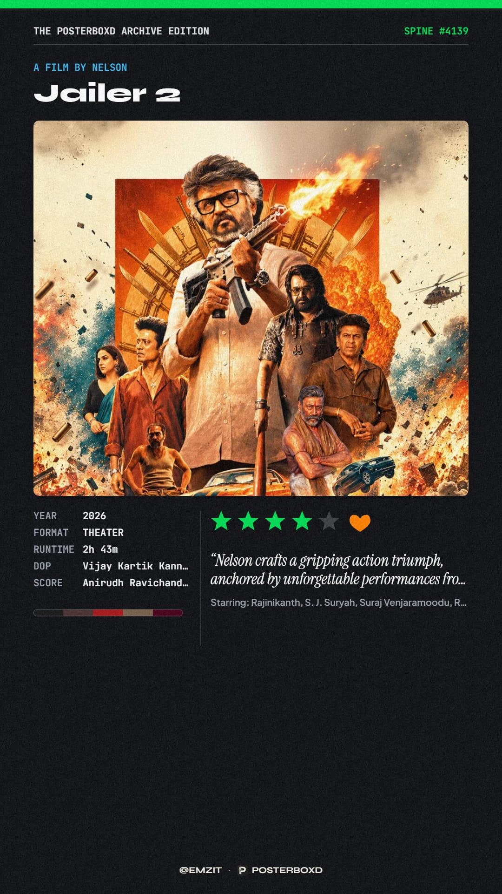
        <br /><sub><b>5. Criterion Split</b></sub>
      </td>
      <td align="center" width="33%">
        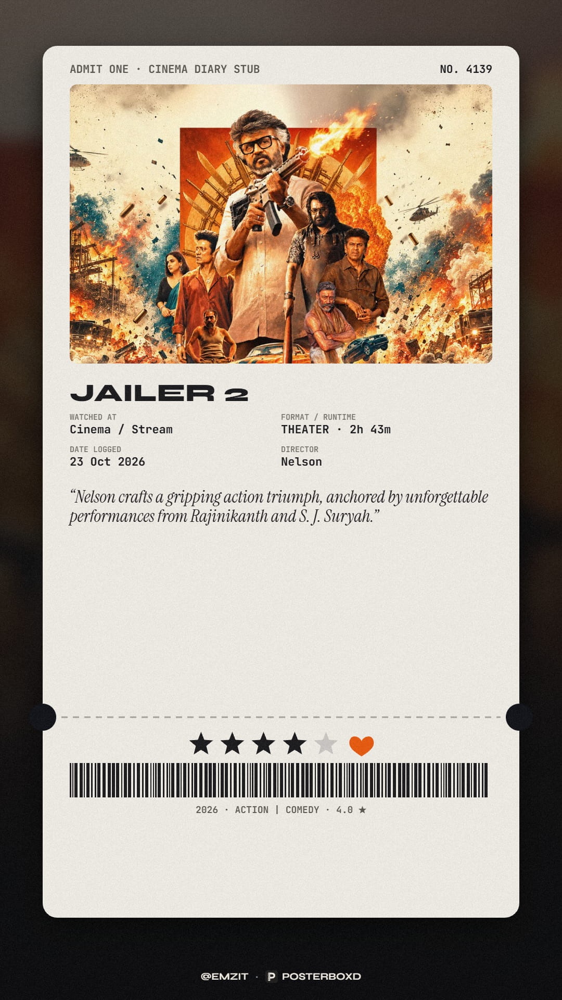
        <br /><sub><b>6. Cinema Ticket Stub</b></sub>
      </td>
    </tr>
    <tr>
      <td align="center" width="33%">
        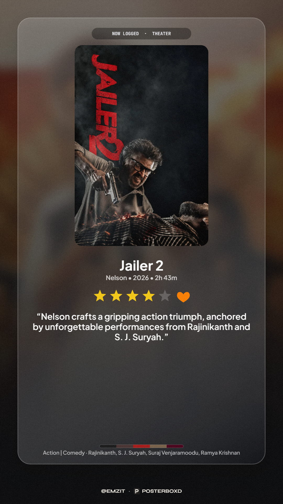
        <br /><sub><b>7. iOS Glass Card</b></sub>
      </td>
      <td align="center" width="33%">
        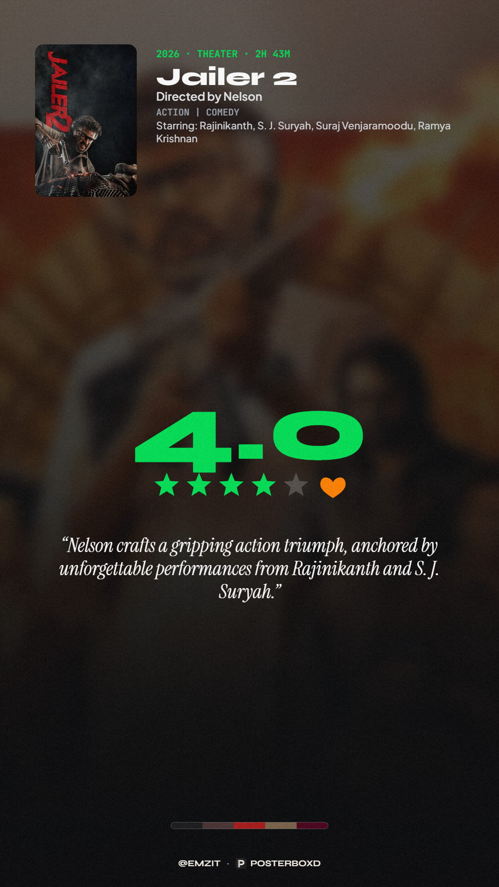
        <br /><sub><b>8. Big Score</b></sub>
      </td>
      <td align="center" width="33%">
        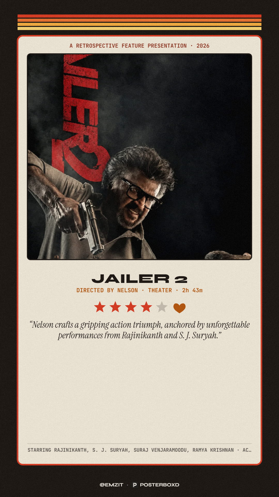
        <br /><sub><b>9. 70s Retro</b></sub>
      </td>
    </tr>
    <tr>
      <td align="center" width="33%">
        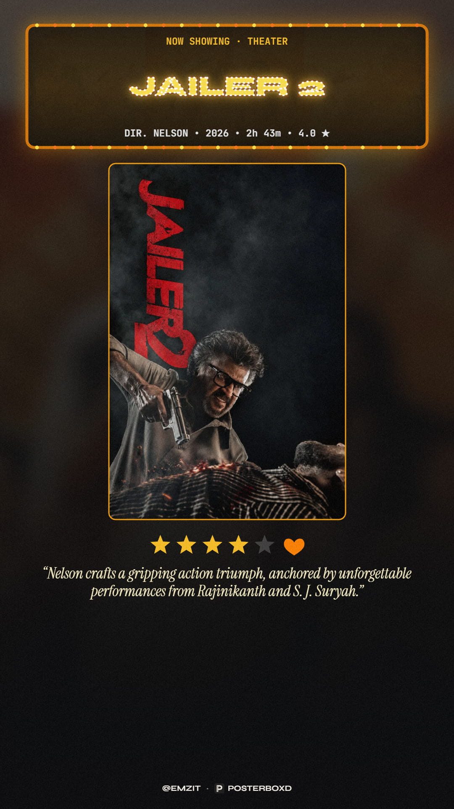
        <br /><sub><b>10. Cinema Marquee</b></sub>
      </td>
      <td align="center" width="33%">
        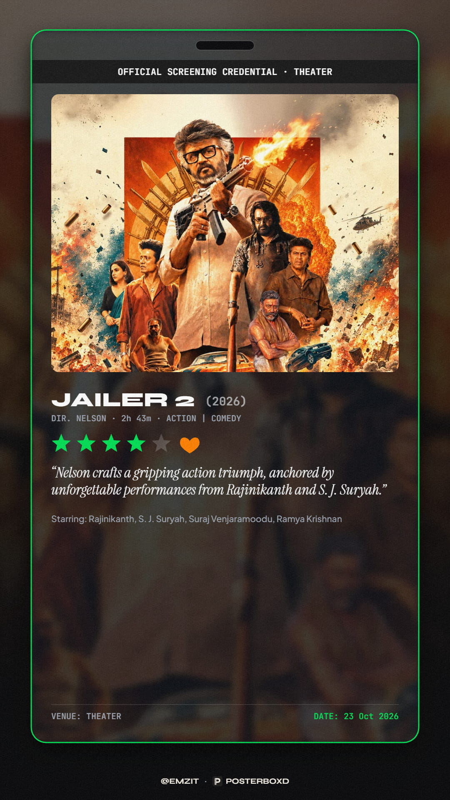
        <br /><sub><b>11. VIP Pass</b></sub>
      </td>
      <td align="center" width="33%">
        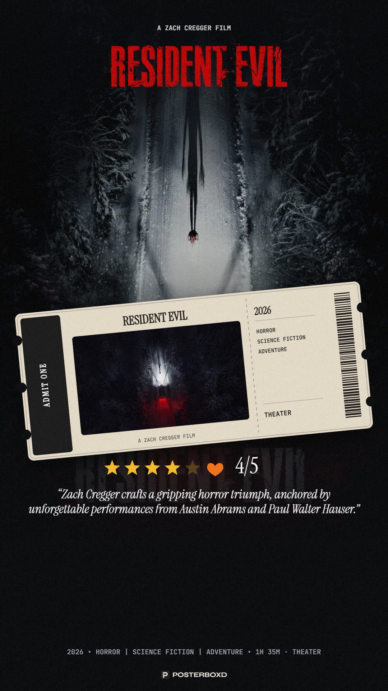
        <br /><sub><b>Floating Ticket (Alternate)</b></sub>
      </td>
    </tr>
  </table>
</div>

---

## Table of Contents

- [Features](#features)
- [Poster Styles](#poster-styles)
- [Prerequisites](#prerequisites)
- [Live Site & Running Locally](#live-site--running-locally)
- [Usage Guide](#usage-guide)
- [Configuration & Storage](#configuration--storage)
- [Project Architecture](#project-architecture)
- [Lineage & Open Source Attributions](#lineage--open-source-attributions)
- [Contributing](#contributing)
- [License](#license)

---

## Features

### Content & Media Discovery
- **TMDB Integration:** Live search across movies and TV series using [The Movie Database (TMDB) API](https://developer.themoviedb.org/docs), retrieving high-res posters, backdrops, transparent title logos, cast, director/creator credits, release dates, runtime, and genres.
- **Letterboxd Review Import:** Paste any review URL (standard `letterboxd.com/<user>/film/<slug>/` or short `https://boxd.it/<code >` links) or raw review JSON to dynamically search, preview dropdown cards, and extract review text, star ratings, review date, liked status, and reviewer handle.
- **Rating Integrity & Lock:** Imported Letterboxd ratings are locked and prioritized strictly so user review scores remain authentic.
- **TMDb Missing Key Awareness:** Built-in popup modal and persistent top warning banner informing users when proceeding without a TMDb key, detailing metadata expectations.
- **State Isolation & Zero Dummy Data:** Dedicated `resetMediaState` engine ensuring every new search or review import is clean: unavailable crew or artwork fields remain blank without fallback dummy strings or bleed from previous finds.
- **TV Series & Episode Specificity:** Dedicated TV episode selector allowing you to target specific seasons and episodes (e.g., *Succession S04E03*) with episode titles and metadata.
- **Review Customization:** Custom 0–5★ star ratings (including half-stars), heart toggle, viewing medium pills (Theater, IMAX, Dolby Cinema, 70mm, 4DX, RealD 3D, Netflix, Prime Video, JioHotstar, OTT), tags, and custom venue/date input.
- **Context-Aware Scannable QR Codes:** On-poster QR code linking directly to the authentic Letterboxd review, automatically scoped and visible only when importing from a review URL.

### Visual Design & Customization
- **11 Curated Poster Styles:** From vintage admission tickets and classic Criterion editions to editorial layouts, retro grindhouse bills, cinema marquees, and glassmorphism cards.
- **Cinema Marquee Bulb Illumination:** Toggle between illuminated retro incandescent lightbulbs and vector typography, with a 1.3× scaled main marquee title.
- **Adaptive Palette Color Theming:** Automatic 5-swatch palette sampling from the artwork to dynamically theme accents, ticket stubs, and header bylines with high contrast.
- **3 Export Aspect Ratios:** 9:16 (Stories/Reels 1080×1920), 4:5 (Instagram portrait 1080×1350), and 2:3 (Classic cinema 1200×1800).
- **Artwork & Palette Controls:** Backdrop blur, brightness tint, focal-point crop offset sliders (X & Y), poster sizing, corner radius, film grain overlay, and custom gradient accents.
- **Interactive Move & Resize Mode:** Click and drag canvas elements or scale them with hotkeys; custom transforms are automatically saved per poster style.

### Export & Workflow
- **Export Options:** Download as high-res PNG, copy image directly to system clipboard, or share via the native Web Share API.
- **Fetch History:** Stored locally in your browser so you can revisit past posters with a single tap.
- **Offline & Preset Mode:** Built-in offline demo catalog (*Dune: Part Two*, *Blade Runner 2049*, *In the Mood for Love*, *Succession*) ready to use without an API key.

---

## Poster Styles

| # | Style | Description | Media Support |
|---|-------|-------------|---------------|
| 1 | **Floating Vintage Ticket** | Perforated admission ticket floating over blurred backdrop | Movies |
| 2 | **Classic Centered** | Clean, minimalist cinema presentation with central artwork | Movies & TV |
| 3 | **Full-Bleed Editorial** | Modern editorial magazine layout with bold typography | Movies & TV |
| 4 | **Polaroid Gallery Frame** | Instant camera frame with handwriting font and caption | Movies & TV |
| 5 | **Criterion Arthouse Split** | Iconic Criterion-inspired layout with classic top banner | Movies & TV |
| 6 | **Full Cinema Ticket Stub** | Authentic vintage admission ticket stub with barcode | Movies |
| 7 | **Apple iOS Glass Card** | Glassmorphism card overlay with subtle frosted blur | Movies & TV |
| 8 | **Big Score and One-Liner** | Scoreboard rating emphasis with large highlight quote | Movies & TV |
| 9 | **70s Retro Grindhouse** | Distressed warm vintage palette with retro film typography | Movies & TV |
| 10 | **Movie Theater Marquee** | Retro illuminated cinema marquee sign bill | Movies |
| 11 | **VIP Screening Pass** | Lanyard badge with barcode and security pass aesthetics | Movies & TV |

---

## Prerequisites

- Any modern web browser with HTML5 Canvas and ES Modules support (Chrome, Firefox, Safari, Edge).
- A free [TMDB API Key](https://www.themoviedb.org/settings/api) (v3 key or v4 read access token) for live movie and TV searching. *(Optional if using demo presets).*
- A local static HTTP server when developing or running locally (browsers block ES modules on direct `file://` execution due to CORS).

---

## Live Site & Running Locally

### Live Site
PosterBoxd Studio is live and hosted via GitHub Pages with a custom domain:
```
https://posterboxd.com/
```
*(Also accessible via `https://emmanuelmavely.github.io/PosterBoxdPlus/`)*

### Running Locally

1. **Clone the repository:**
   ```bash
   git clone https://github.com/emmanuelmavely/PosterBoxdPlus.git
   cd PosterBoxdPlus
   ```

2. **Start any local static server:**

   *Using Python 3:*
   ```bash
   python3 -m http.server 8080
   ```

   *Using Node.js (`npx`):*
   ```bash
   npx -y http-server -p 8080 -c-1
   ```

   *Using VS Code:*
   Install the **Live Server** extension, right-click `index.html`, and select **Open with Live Server**.

3. **Open in your browser:**
   Navigate to `http://localhost:8080`.

---

## Usage Guide

1. **Connect TMDB API Key:** Click the Key icon in the top header to enter your TMDB v3 API key or v4 token. It is stored securely in your browser's `localStorage`.
2. **Select Media or Import Review:**
   - Search any title in the search pill (e.g. *Challengers*, *Severance*).
   - Or paste a Letterboxd review URL (e.g. `https://letterboxd.com/user/film/title/` or `https://boxd.it/gUpRkb`).
   - Or click any trending now-playing chip or demo preset.
3. **Customize Your Review:** Add your rating, heart like status, theater medium, custom tags, and review text in the Review Form.
4. **Style the Poster:** Switch between the 11 poster archetypes, toggle aspect ratios, adjust backdrop blur/opacity, and choose alternate posters or backdrops.
5. **Interactive Drag & Resize:** Click **Move & Resize** to reposition or rescale text blocks, ratings, or artwork hitboxes directly on the canvas.
6. **Export:** Click **Save PNG** to download, **Copy** to copy to clipboard, or **Share** to send via mobile share sheets.

---

## Configuration & Storage

PosterBoxd Studio requires no server backend; all user settings and cache are persisted in browser `localStorage`:

| Key | Storage Target | Description |
|-----|----------------|-------------|
| `posterboxd_tmdb_key` | `localStorage` | TMDB API v3 key or v4 access token |
| `posterboxd_username` | `localStorage` | Default Letterboxd username for reviews and QR code generation |
| `posterboxd_transforms_v3` | `localStorage` | Custom element positions, scales, and offsets per poster style |
| `posterboxd_fetch_history_v1` | `localStorage` | History list of your recent 35 lookups and posters |

---

## Project Architecture

```
PosterBoxdPlus/
├── index.html                     # Application HTML shell and UI layout
├── favicon.svg                    # Vector brand logo
├── CHANGELOG.md                   # Release history and feature notes
├── README.md                      # Project documentation and attributions
├── preview/                       # Compressed high-resolution sample poster outputs
├── src/
│   ├── main.js                    # Modular entry point initializing UI controllers
│   ├── state.js                   # Reactive centralized state & storage hydration
│   ├── constants.js               # Style names, aspect ratios, and brand assets
│   ├── utils.js                   # Text truncation, slugification, and string helpers
│   ├── styles.css                 # Custom scrollbars, sliders, and canvas styling
│   ├── controllers/
│   │   ├── media.js               # Media search, TMDB details, and season fetching
│   │   └── letterboxd-import.js   # Letterboxd review parsing & artwork enrichment
│   ├── services/
│   │   ├── tmdb.js                # TMDB API client & regional now-playing queries
│   │   ├── letterboxd.js          # Letterboxd web scraper & short URL resolver
│   │   ├── media-assets.js        # CORS image loader & color palette extractor
│   │   └── storage.js             # LocalStorage manager for history & transforms
│   ├── data/
│   │   ├── demo-catalog.js        # Offline presets (Dune 2, BR2049, Succession)
│   │   └── procedural-art.js      # Procedural fallback canvas artwork
│   ├── rendering/
│   │   ├── canvas-renderer.js     # Master render scheduler and hit-test manager
│   │   ├── primitives.js          # Drawing helpers (stars, badges, barcodes, logos)
│   │   ├── transforms.js          # Interactive coordinate translation & hitboxes
│   │   ├── qr-code.js             # Canvas QR code generator
│   │   └── posters/               # Modular poster archetype implementations:
│   │       ├── floating-ticket.js # Archetype 1: Floating Vintage Ticket
│   │       ├── classic.js         # Archetype 2: Classic Centered
│   │       ├── editorial.js       # Archetype 3: Full-Bleed Editorial
│   │       ├── polaroid.js        # Archetype 4: Polaroid Gallery Frame
│   │       ├── criterion.js       # Archetype 5: Criterion Arthouse Split
│   │       ├── ticket.js          # Archetype 6: Full Cinema Ticket Stub
│   │       ├── ios-glass.js       # Archetype 7: Apple iOS Glass Card
│   │       ├── scoreboard.js      # Archetype 8: Big Score and One-Liner
│   │       ├── retro.js           # Archetype 9: 70s Retro Grindhouse
│   │       ├── marquee.js         # Archetype 10: Movie Theater Marquee
│   │       └── vip-pass.js        # Archetype 11: VIP Screening Pass
│   └── ui/
│       ├── navigation.js          # Multi-view navigation and breadcrumb routing
│       ├── search.js              # Live search dropdown and URL paste handling
│       ├── review-form.js         # Rating, medium, tags, and review controls
│       ├── design-controls.js     # Archetype picker, sliders, and layout buttons
│       ├── export-controls.js     # PNG export, clipboard, and Web Share API
│       ├── history.js             # Fetch history modal and entry restorer
│       ├── assets.js              # Poster/backdrop selectors and color swatches
│       ├── qr-controls.js         # QR code toggle & custom URL input
│       ├── api-modal.js           # TMDB API key configuration modal
│       └── toast.js               # Non-blocking animated notification toasts
```

---

## Lineage & Open Source Attributions

### Original Lineage
- This project is based on and evolved directly from Emmanuel Mavely's original project [**PosterBoxd**](https://github.com/emmanuelmavely/PosterBoxd).

### Data & External APIs
- **[The Movie Database (TMDB)](https://www.themoviedb.org/):** Film and television metadata, high-resolution posters, backdrops, and actor/crew credits are provided by TMDB.  
  *Attribution Notice:* This product uses the TMDB API but is not endorsed or certified by TMDB.
- **[Letterboxd](https://letterboxd.com/):** Review format and visual style inspired by Letterboxd. PosterBoxd is an independent project and is not affiliated with Letterboxd Limited.
- **[cors.tyxc.org](https://cors.tyxc.org):** Primary high-speed CORS proxy used for fetching Letterboxd review pages on client-side requests.
- **[Microlink API](https://microlink.io/):** Used as a fallback service for resolving Letterboxd metadata and short link redirects (`boxd.it`).

### Open Source Libraries & UI Toolkits
- **[qrcode-generator](https://github.com/kazuhikoarase/qrcode-generator):** Lightweight client-side QR code generator created by Kazuhiko Arase.
- **[Tailwind CSS](https://tailwindcss.com/):** Utility-first CSS framework for modern, responsive UI components.
- **[Font Awesome Free](https://fontawesome.com/):** Clean iconography for UI navigation and badge elements.
- **[Google Fonts](https://fonts.google.com/):** Typography powered by *Plus Jakarta Sans*, *Syne*, *Playfair Display*, *Cinzel*, *JetBrains Mono*, *Bebas Neue*, and *Caveat*.

---

## Contributing

Contributions, bug reports, and suggestions are welcome!
1. Fork the repository.
2. Create your feature branch (`git checkout -b feature/new-style`).
3. Commit your changes (`git commit -m 'feat: add new poster archetype'`).
4. Push to the branch (`git push origin feature/new-style`).
5. Open a Pull Request.

---

## License

This project is licensed under the [MIT License](LICENSE).
